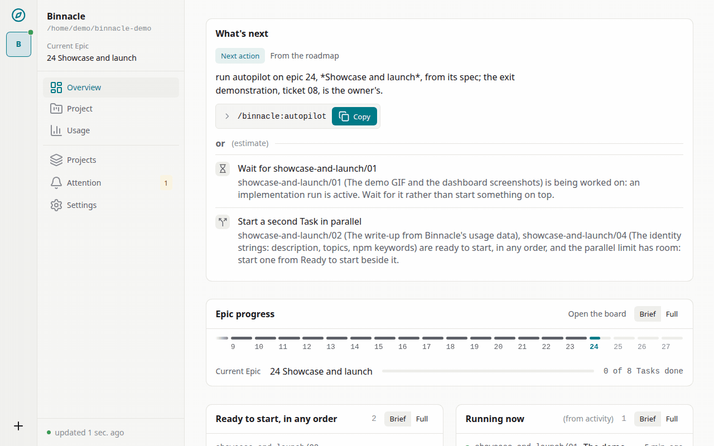
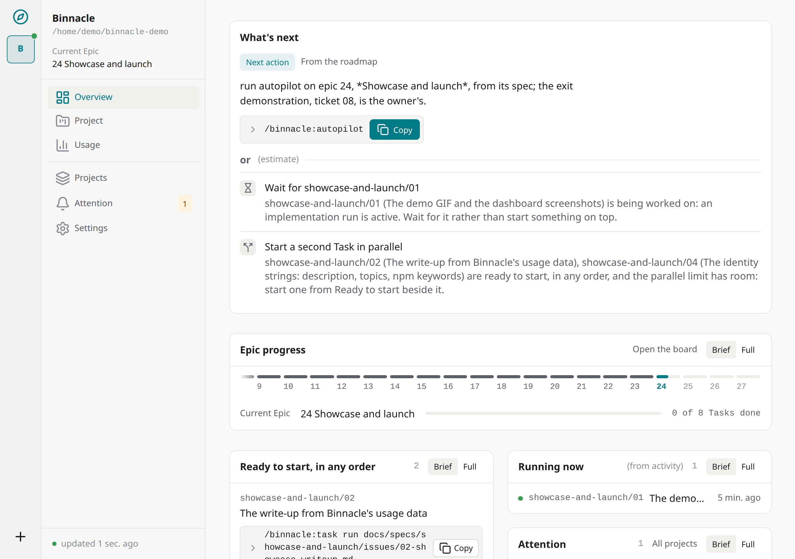
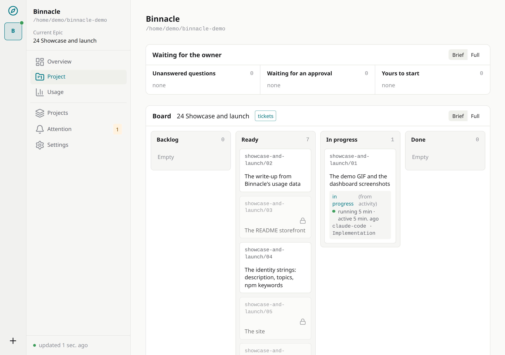
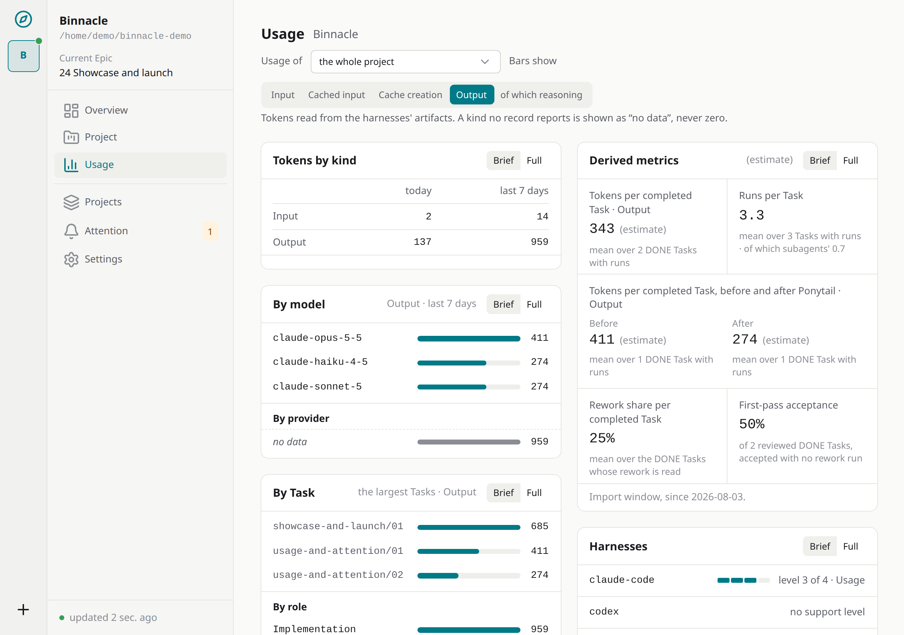
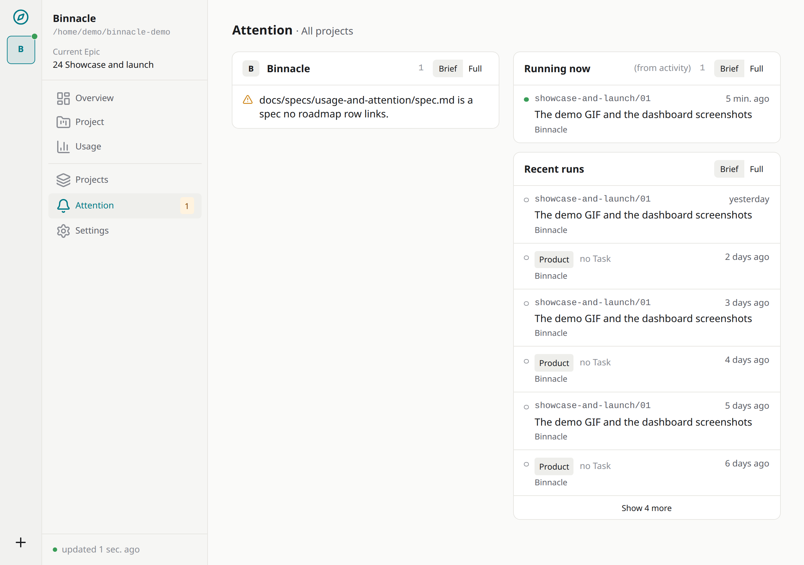

<p align="center">
  
</p>

<h1 align="center">Binnacle Dev</h1>

<p align="center">
  <strong>One project memory. Any coding agent.</strong><br>
  <strong>Claude today. Codex tomorrow. Your project never starts from zero.</strong>
</p>

<p align="center">
  <a href="https://github.com/it-bbox/binnacle/actions/workflows/ci.yml"></a>
  <a href="https://www.npmjs.com/package/@it-bbox/binnacle"></a>
  <a href="LICENSE"></a>
  <a href="https://github.com/it-bbox/binnacle/blob/main/package.json"></a>
</p>

<p align="center">
  <a href="https://it-bbox.github.io/binnacle/">Site</a> ·
  <a href="https://it-bbox.github.io/binnacle/quick-start">Quick start</a> ·
  <a href="https://it-bbox.github.io/binnacle/operations/01-new-project">Guides</a> ·
  <a href="#containers">Containers</a> ·
  <a href="#mod">Mod</a> ·
  <a href="https://github.com/it-bbox/binnacle/discussions">Discussions</a>
</p>

_Русская версия: [README.ru.md](README.ru.md)._

Binnacle is a local, provider-agnostic **AI Engineering Control Plane**: persistent project context, workflow and observability across Claude Code, Codex, Gemini, GLM and other coding agents. It keeps project state outside chat sessions, hands fresh agents a compact and current context, collects spend telemetry, and leaves the human in charge of the process.

> A binnacle is the stand that holds a ship's compass in front of the helm. It does not steer and it does not pick the course — it keeps the instruments where the helmsman can read them. That is the whole design brief.

The [Binnacle site](https://it-bbox.github.io/binnacle/) shows the dashboard and a write-up from Binnacle's own usage data, in English and Russian.

## Demo



| Overview | Tasks |
| --- | --- |
|  |  |
| Usage | Attention |
|  |  |

## The problem

Long agent sessions grow expensive, compaction loses detail, and every new agent re-explores the project from scratch. Binnacle moves project state into durable sources — Git, Markdown docs, ADRs, the tracker and a local, rebuildable telemetry store — so a chat is working context, not the project's memory.

> **Project knowledge and task state belong to the project — not to a particular model, chat or coding harness.**

## Requirements

- Node.js 24 LTS, on Linux, macOS or Windows.
- A free loopback port: the daemon serves its dashboard on `http://127.0.0.1:7717` by default; with autostart off, `binn daemon start` takes another port from `BINNACLE_PORT`.

Docker is not needed for Binnacle itself: it is one local daemon, and a container adds a published port and a second home to look after — use it only when your app already runs in one.

## Install

```bash
npm i -g @it-bbox/binnacle
binn daemon start
```

For a one-off run without installing, use `npx -p @it-bbox/binnacle binn`. `binn init` offers to start the daemon at login, and, in Claude Code, the optional Binnacle mod: Binnacle's state beside the chat, no by default. To install the mod later, and to turn it off or remove it:

```bash
claude plugin install binnacle-mod@binnacle --scope user
claude plugin disable binnacle-mod
claude plugin uninstall binnacle-mod
```

## New project: the short path

1. `git init`
2. `binn init` — one plan of everything it sets up, confirmed once.
3. `/binnacle:roadmap` — writes the vision and the epics.
4. `/binnacle:product` — the first Product session.

Then each epic goes `/grill-with-docs` → `/to-spec` → `/to-tickets`, and each ticket `/binnacle:task run <ticket>`, in a session of its own. Details: [New project](docs/operations/01-new-project.md).

## Existing project: the short path

1. `binn audit` — read-only findings; it writes nothing.
2. `binn init` — the same one plan.
3. `/binnacle:roadmap` — epics proposed from the code, the history and the docs.
4. `/binnacle:product` — the first Product session.

Nothing is moved or rewritten without your yes. Details: [Existing project](docs/operations/02-existing-project-adopt.md).

## More

- <a name="mod"></a>[The Binnacle mod for Claude Code](docs/operations/05-installation-checklist.md#the-binnacle-mod-for-claude-code): what it shows beside the chat, and how to turn it off or remove it.
- If a harness cannot find `binn`, see [the installation checklist](docs/operations/05-installation-checklist.md#when-a-harness-cannot-find-binn).
- <a name="containers"></a>To run Binnacle inside your app's dev container or `docker compose` service, see [Binnacle in a container](docs/operations/07-containers.md).
- To develop Binnacle itself, see [CONTRIBUTING.md](CONTRIBUTING.md#from-this-repository).

## Harnesses

Any harness that speaks MCP, or has a shell for `binn call`, gets the project's memory. Above that, Binnacle reads what each harness leaves on disk:

| Harness | Level |
| --- | --- |
| Claude Code (CLI and desktop) | 4 — Live |
| Codex (CLI and desktop) | 4 — Live |
| Gemini CLI | 4 — Live, not verified |
| opencode | 3 — Usage |
| ZCode | 3 — Usage |
| pi | 3 — Usage |
| Antigravity | 2 — Attribution, not verified |
| any other | 1 — Context |

What each level means and how each harness is reached: [Working from another harness](docs/operations/06-other-harnesses.md).

## User guides

- [New project](docs/operations/01-new-project.md)
- [Existing project](docs/operations/02-existing-project-adopt.md)
- [External tools](docs/operations/03-external-tools.md)
- [Security and resilience](docs/operations/04-security-resilience.md)
- [Installation checklist](docs/operations/05-installation-checklist.md)
- [Working from another harness](docs/operations/06-other-harnesses.md)
- [Binnacle in a container](docs/operations/07-containers.md)
- [Contributing](CONTRIBUTING.md) and the [security policy](SECURITY.md)

## Further reading

The project's design, in this order: [scope](docs/00-scope.md), [architecture](docs/01-architecture.md), [Project Brain](docs/02-project-brain.md), [product workflow](docs/workflow/01-product-workflow.md), [development workflow](docs/workflow/02-development-workflow.md), [MCP and skills](docs/03-mcp-and-skills.md), [telemetry and dashboard](docs/04-telemetry-dashboard.md), [MVP plan](docs/05-mvp-plan.md). Architectural decisions are in [docs/adr/](docs/adr/).

## Licence

Apache-2.0. See [LICENSE](LICENSE).
