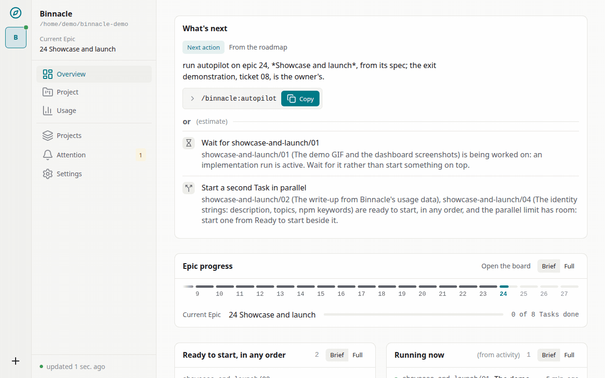
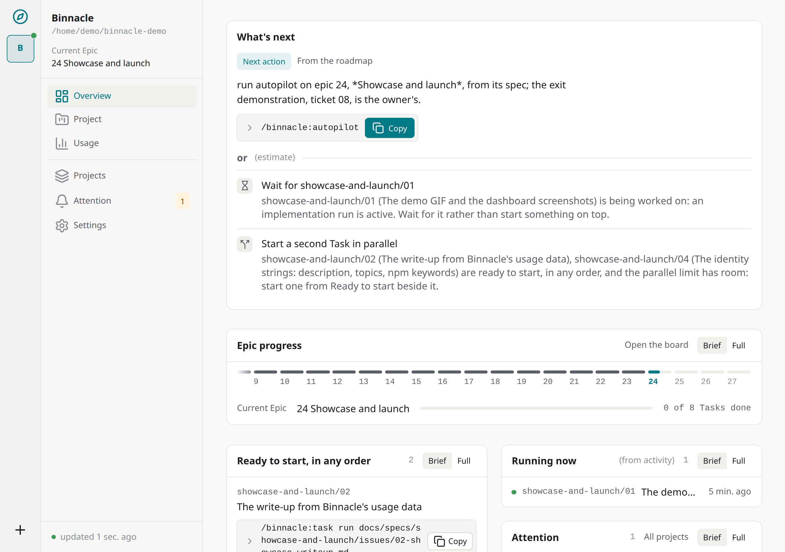
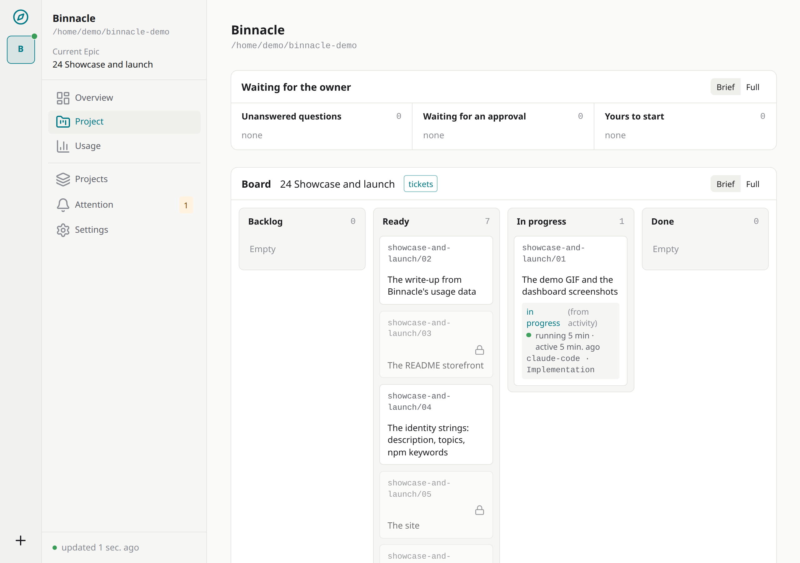
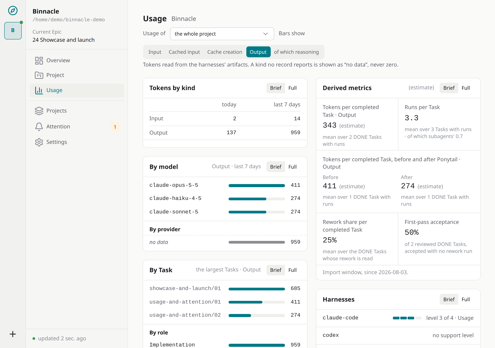
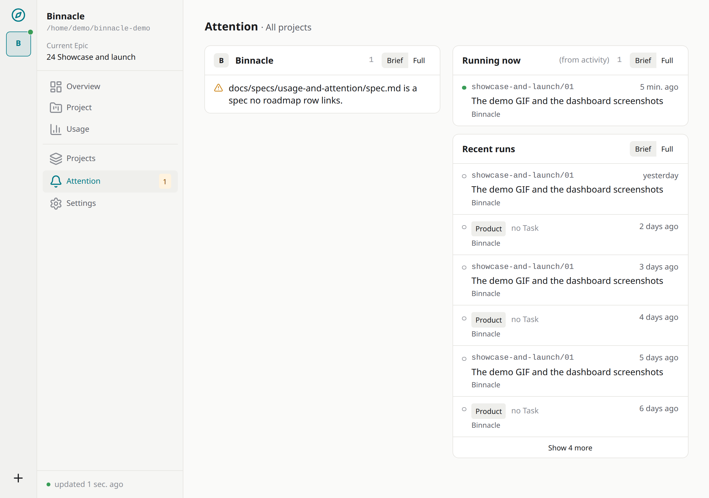

<p align="center">
  
</p>

<h1 align="center">Binnacle Dev</h1>

<p align="center">
  <strong>Одна память проекта. Любой coding agent.</strong><br>
  <strong>Сегодня Claude, завтра Codex. Проект больше не начинается с нуля.</strong>
</p>

<p align="center">
  <a href="https://github.com/it-bbox/binnacle/actions/workflows/ci.yml"></a>
  <a href="https://www.npmjs.com/package/@it-bbox/binnacle"></a>
  <a href="LICENSE"></a>
  <a href="https://github.com/it-bbox/binnacle/blob/main/package.json"></a>
</p>

<p align="center">
  <a href="https://it-bbox.github.io/binnacle/">Сайт</a> ·
  <a href="#установка">Быстрый старт</a> ·
  <a href="#руководства">Руководства</a> ·
  <a href="#containers">Контейнеры</a> ·
  <a href="#mod">Мод</a> ·
  <a href="https://github.com/it-bbox/binnacle/discussions">Discussions</a>
</p>

_English version: [README.md](README.md). Этот файл — русский дубликат; обновляется вместе с `README.md`._

Binnacle — локальный provider-agnostic **AI Engineering Control Plane**: сохраняемый контекст проекта, workflow и наблюдаемость поверх Claude Code, Codex, Gemini, GLM и других coding agents. Он хранит состояние проекта вне чатов, даёт свежим агентам компактный актуальный контекст, собирает telemetry по расходам и оставляет человека главным управляющим процессом.

> Нактоуз (binnacle) — тумба с компасом перед штурвалом. Он не рулит и не выбирает курс: он держит приборы там, где рулевой их видит. В этом всё техзадание.

Сайт [Binnacle](https://it-bbox.github.io/binnacle/) показывает демо и разбор по собственным данным Binnacle о расходах, на английском и русском.

## Демо



| Обзор | Задачи |
| --- | --- |
|  |  |
| Расход | Внимание |
|  |  |

## Что решаем

Длинные сессии агентов дорожают, compaction теряет детали, а каждый новый агент заново исследует проект. Binnacle выносит состояние проекта в устойчивые источники — Git, Markdown-документацию, ADR, tracker и локальное восстановимое хранилище telemetry, — так что чат остаётся рабочим контекстом, а не памятью проекта.

> **Project knowledge и task state принадлежат проекту, а не конкретной модели, чату или coding harness.**

## Требования

- Node.js 24 LTS, на Linux, macOS или Windows.
- Свободный loopback-порт: демон отдаёт dashboard на `http://127.0.0.1:7717` по умолчанию; с выключенным автозапуском `binn daemon start` берёт другой порт из `BINNACLE_PORT`.

Docker для самого Binnacle не нужен: это один локальный демон, а контейнер добавляет опубликованный порт и второе хранилище в обслуживание — он нужен, только если ваше приложение уже живёт в контейнере.

## Установка

```bash
npm i -g @it-bbox/binnacle
binn daemon start
```

Для разового запуска без установки — `npx -p @it-bbox/binnacle binn`. `binn init` предлагает запускать daemon при входе в систему, а в Claude Code — ещё и необязательный мод Binnacle: состояние Binnacle рядом с чатом, по умолчанию не ставится. Поставить мод позже, выключить или удалить его:

```bash
claude plugin install binnacle-mod@binnacle --scope user
claude plugin disable binnacle-mod
claude plugin uninstall binnacle-mod
```

## Быстрый путь нового проекта

1. `git init`
2. `binn init` — один план всего, что он настраивает, с одним подтверждением.
3. `/binnacle:roadmap` — записывает видение и эпики.
4. `/binnacle:product` — первая Product-сессия.

Дальше каждый эпик идёт `/grill-with-docs` → `/to-spec` → `/to-tickets`, а каждый тикет — `/binnacle:task run <ticket>`, в отдельной сессии. Подробнее: [Новый проект](docs/operations/01-new-project.ru.md).

## Быстрый путь существующего проекта

1. `binn audit` — находки только для чтения; он ничего не пишет.
2. `binn init` — тот же один план.
3. `/binnacle:roadmap` — эпики, предложенные по коду, истории и документам.
4. `/binnacle:product` — первая Product-сессия.

Без вашего «да» ничего не перемещается и не переписывается. Подробнее: [Существующий проект](docs/operations/02-existing-project-adopt.ru.md).

## Подробнее

- <a name="mod"></a>[Мод Binnacle для Claude Code](docs/operations/05-installation-checklist.ru.md#мод-binnacle-для-claude-code): что он показывает рядом с чатом и как его выключить или удалить.
- Если harness не находит `binn`, см. [чек-лист установки](docs/operations/05-installation-checklist.ru.md#когда-harness-не-находит-binn).
- <a name="containers"></a>Как запустить Binnacle в dev container или сервисе `docker compose` вашего приложения — в [Binnacle в контейнере](docs/operations/07-containers.ru.md).
- Разработка самого Binnacle — в [CONTRIBUTING.ru.md](CONTRIBUTING.ru.md#из-этого-репозитория).

## Harness

Любой harness, который умеет MCP или имеет shell для `binn call`, получает память проекта. Сверх этого Binnacle читает то, что каждый harness оставляет на диске:

| Harness | Уровень |
| --- | --- |
| Claude Code (CLI и desktop) | 4 — Live |
| Codex (CLI и desktop) | 4 — Live |
| Gemini CLI | 4 — Live, не проверен |
| opencode | 3 — Usage |
| ZCode | 3 — Usage |
| pi | 3 — Usage |
| Antigravity | 2 — Attribution, не проверен |
| любой другой | 1 — Context |

Что значит каждый уровень и как Binnacle достигает каждого harness: [Работа из другого harness](docs/operations/06-other-harnesses.ru.md).

## Руководства

- [Новый проект](docs/operations/01-new-project.ru.md)
- [Существующий проект](docs/operations/02-existing-project-adopt.ru.md)
- [Внешние инструменты](docs/operations/03-external-tools.ru.md)
- [Безопасность и устойчивость](docs/operations/04-security-resilience.ru.md)
- [Чек-лист установки](docs/operations/05-installation-checklist.ru.md)
- [Работа из другого harness](docs/operations/06-other-harnesses.ru.md)
- [Binnacle в контейнере](docs/operations/07-containers.ru.md)
- [Участие в разработке](CONTRIBUTING.ru.md) и [политика безопасности](SECURITY.ru.md)

## Что почитать дальше

Устройство проекта, на английском, в таком порядке: [scope](docs/00-scope.md), [архитектура](docs/01-architecture.md), [Project Brain](docs/02-project-brain.md), [product workflow](docs/workflow/01-product-workflow.md), [development workflow](docs/workflow/02-development-workflow.md), [MCP и skills](docs/03-mcp-and-skills.md), [telemetry и dashboard](docs/04-telemetry-dashboard.md), [план MVP](docs/05-mvp-plan.md). Архитектурные решения — в [docs/adr/](docs/adr/).

## Лицензия

Apache-2.0. См. [LICENSE](LICENSE).
