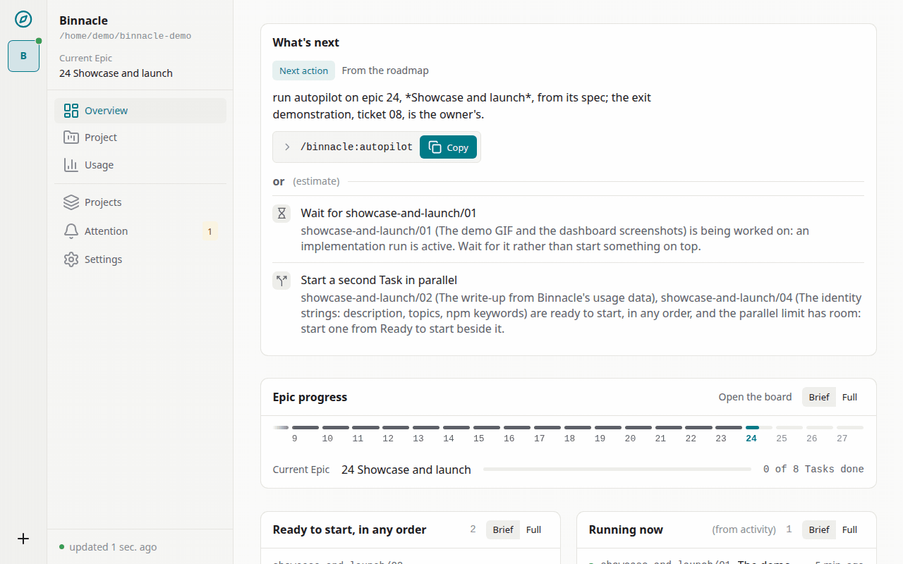
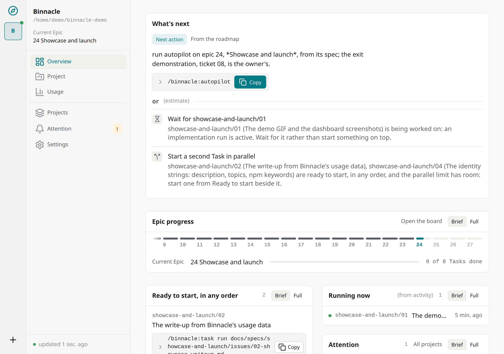
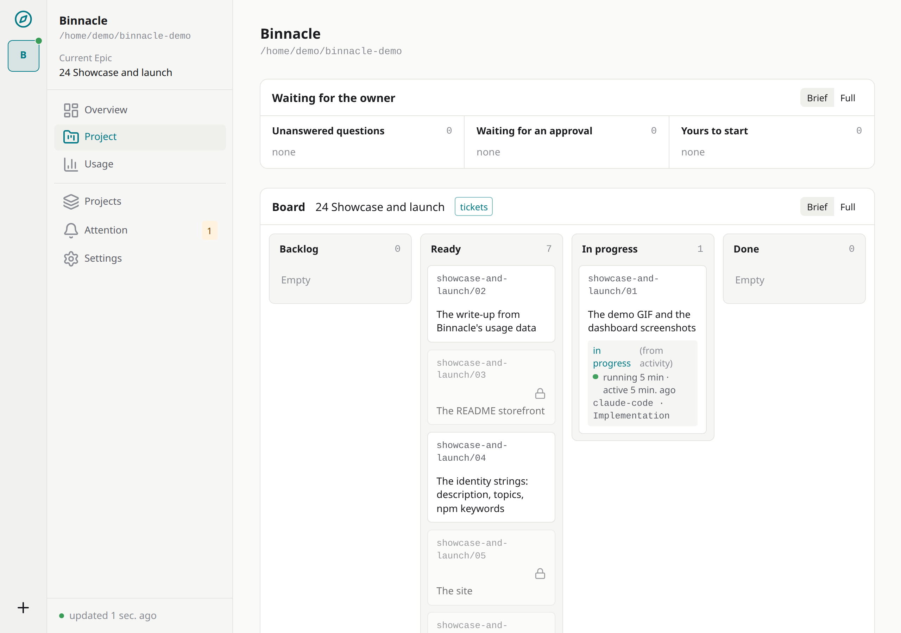
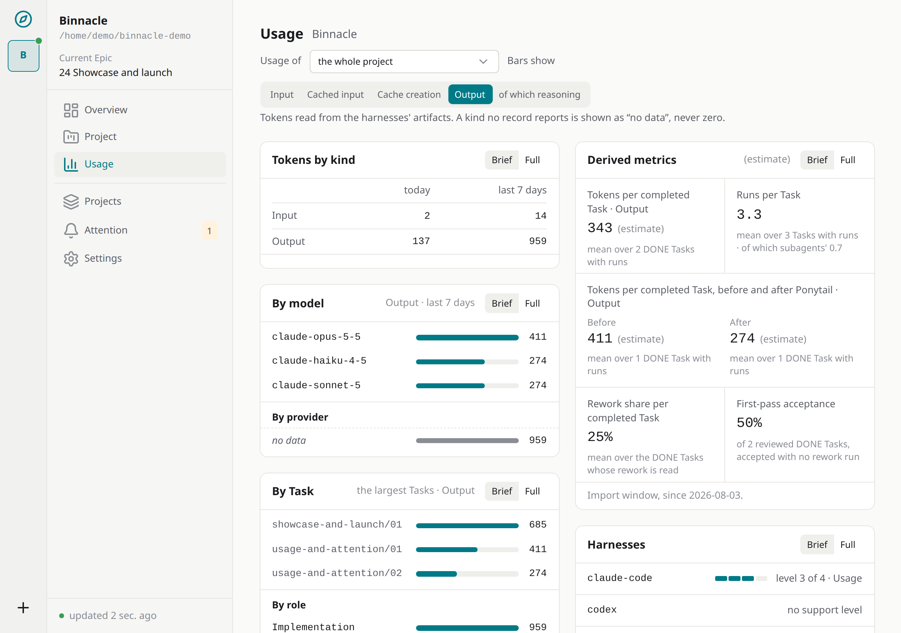
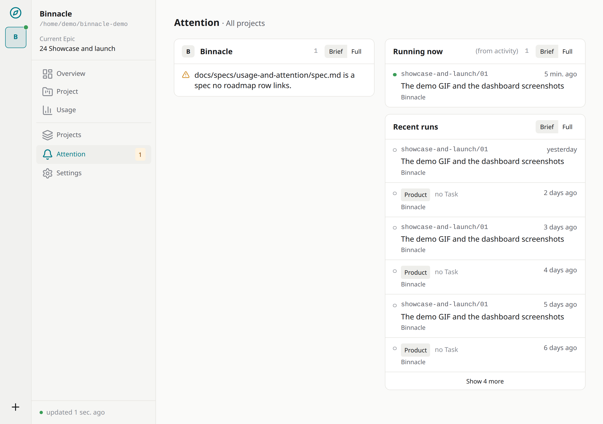

[](https://github.com/it-bbox/binnacle/actions/workflows/ci.yml)
[](https://www.npmjs.com/package/@it-bbox/binnacle)
[](https://github.com/it-bbox/binnacle/blob/main/LICENSE)
[](https://github.com/it-bbox/binnacle/blob/main/package.json)

<div class="split">

<div class="split-text">

Binnacle is a local, provider-agnostic **AI Engineering Control Plane**: persistent project context, workflow and observability across Claude Code, Codex, Gemini, GLM and other coding agents. It keeps project state outside chat sessions, hands fresh agents a compact and current context, collects spend telemetry, and leaves the human in charge of the process.

</div>

<div class="split-media">



</div>

</div>

## Install

```bash
npm i -g @it-bbox/binnacle
binn daemon start
```

## Requirements

- Node.js 24 LTS, on Linux, macOS or Windows.
- A free loopback port: the daemon serves its dashboard on `http://127.0.0.1:7717` by default; with autostart off, `binn daemon start` takes another port from `BINNACLE_PORT`.

Docker is not needed for Binnacle itself: it is one local daemon, and a container adds a published port and a second home to look after — use it only when your app already runs in one.

## Screenshots

| Overview | Tasks |
| --- | --- |
|  |  |
| Usage | Attention |
|  |  |

## Where to go next

- [The repository](https://github.com/it-bbox/binnacle) and [@it-bbox/binnacle on npm](https://www.npmjs.com/package/@it-bbox/binnacle)
- [Quick start](quick-start.md) — install it and get a project going
- [The guides](operations/01-new-project.md) — every step, from the first project to a container
- [Containers and the mod](containers-and-mod.md)
- [What Binnacle's own work cost](showcase/write-up.md) — the write-up from its own usage data
