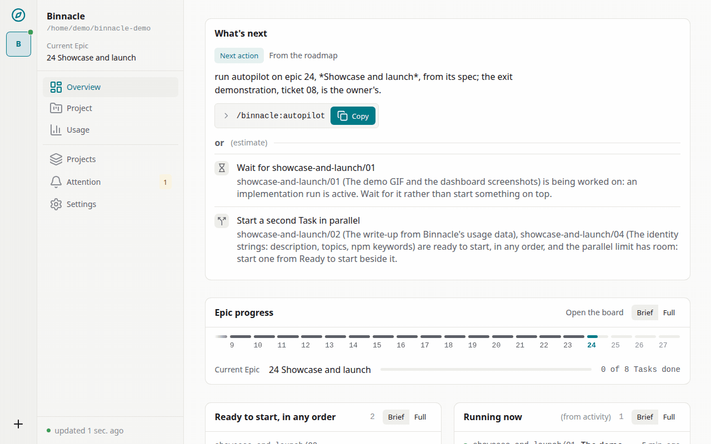
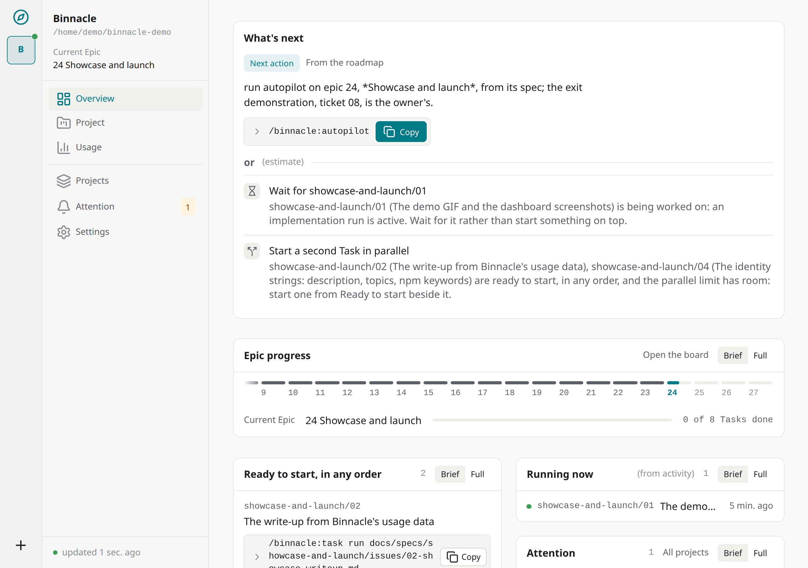
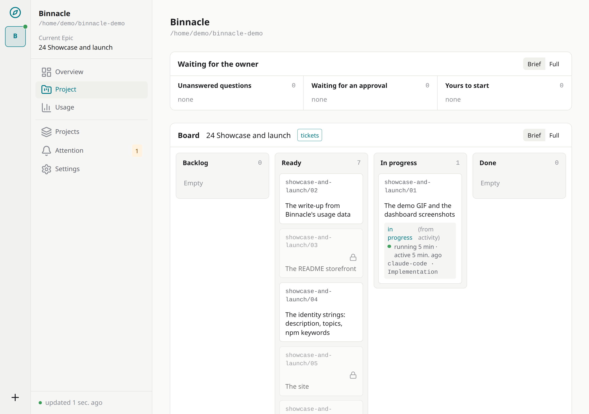
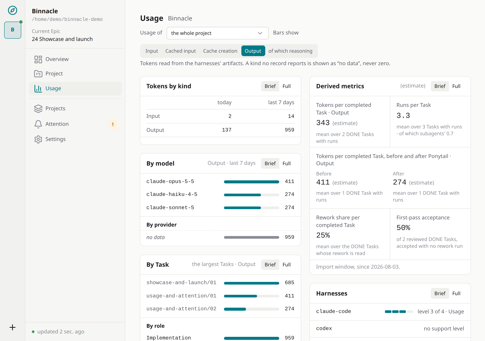
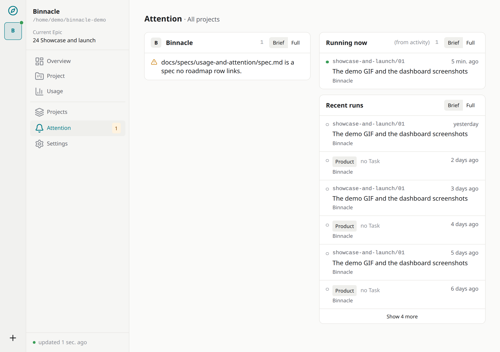

# Binnacle Dev

**Одна память проекта. Любой coding agent.**

Binnacle — локальный provider-agnostic **AI Engineering Control Plane**: сохраняемый контекст проекта, workflow и наблюдаемость поверх Claude Code, Codex, Gemini, GLM и других coding agents. Он хранит состояние проекта вне чатов, даёт свежим агентам компактный актуальный контекст, собирает telemetry по расходам и оставляет человека главным управляющим процессом.

[](https://github.com/it-bbox/binnacle/actions/workflows/ci.yml)
[](https://www.npmjs.com/package/@it-bbox/binnacle)
[](https://github.com/it-bbox/binnacle/blob/main/LICENSE)
[](https://github.com/it-bbox/binnacle/blob/main/package.json)



## Установка

```bash
npm i -g @it-bbox/binnacle
binn daemon start
```

## Требования

- Node.js 24 LTS, на Linux, macOS или Windows.
- Свободный loopback-порт: демон отдаёт dashboard на `http://127.0.0.1:7717` по умолчанию; с выключенным автозапуском `binn daemon start` берёт другой порт из `BINNACLE_PORT`.

Docker для самого Binnacle не нужен: это один локальный демон, а контейнер добавляет опубликованный порт и второе хранилище в обслуживание — он нужен, только если ваше приложение уже живёт в контейнере.

## Скриншоты

| Обзор | Задачи |
| --- | --- |
|  |  |
| Расход | Внимание |
|  |  |

## Куда дальше

- [Репозиторий](https://github.com/it-bbox/binnacle) и [@it-bbox/binnacle в npm](https://www.npmjs.com/package/@it-bbox/binnacle)
- [Быстрый старт](quick-start.ru.md) — установить и запустить первый проект
- [Руководства](operations/01-new-project.ru.md) — каждый шаг, от первого проекта до контейнера
- [Контейнеры и мод](containers-and-mod.ru.md)
- [Сколько стоила работа над самим Binnacle](showcase/write-up.ru.md) — разбор по его собственным данным об использовании
